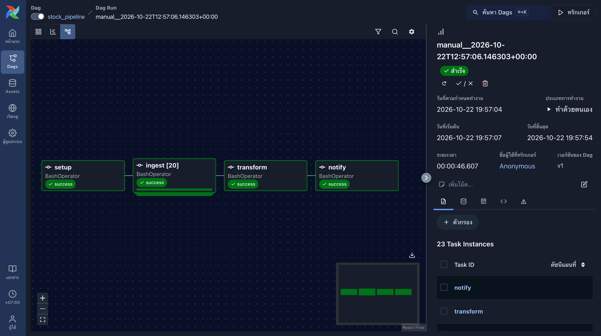

# US Stock Data Pipeline

Every weekday after the US market closes, Airflow downloads daily prices for 20 US stocks from yfinance, checks the data, and loads it into PostgreSQL as a star schema. Everything runs in Docker Compose. I built it to practice the basics of data engineering: pulling data from an API, cleaning it, modeling it, scheduling it, and making sure reruns are safe.

The database currently has about 25,000 rows (20 tickers, 5 years of daily prices).



## How it works

The DAG runs at 17:00 New York time, Monday to Friday. It has four steps:

```
setup  ->  ingest (one task per ticker)  ->  transform  ->  notify
```

```
  yfinance
     |
     v
  Data quality checks   (missing values, non-positive prices, high < low, negative volume)
     |
     v
  raw.stock_prices      (upsert on ticker + trade_date)
     |
     v
  SQL transform         (daily change % using LAG, marks trading days)
     |
     v
  analytics.fact_stock_prices  +  analytics.dim_stock  +  analytics.dim_date
```

- **setup** creates the schemas and tables if they don't exist, and loads `dim_stock` from `data/stocks.csv`.
- **ingest** has one task per ticker (Airflow dynamic task mapping), max 4 running at the same time so I don't hit yfinance too hard. If one ticker fails, only that task is retried (2 retries, 10 minutes apart). The other tickers are not affected.
- **transform** builds `fact_stock_prices` from the raw table. It runs even if some tickers failed, as long as at least one worked.
- **notify** sends a short summary to Discord (total rows, number of tickers, latest date).

### Incremental loading

The pipeline does not use a fixed time window. For each ticker it looks up the latest `trade_date` already in `raw.stock_prices` and downloads from that date onward. So if the pipeline is off for two weeks, the next run just catches up by itself.

- It downloads the latest date again on purpose. yfinance can return a candle that is not finished yet, and the upsert replaces it with the final one on the next run.
- A new ticker (nothing in the database yet) is loaded from `BACKFILL_START` (default `2021-10-01`).
- `FULL_BACKFILL=1` forces every ticker to reload from `BACKFILL_START`. I used this once to go from 1 year to 5 years of history.

### Other design choices

- **Reruns are safe.** The tables use `ON CONFLICT (ticker, trade_date) DO UPDATE`, so running twice never creates duplicate rows. I checked this by running the pipeline twice in a row and counting the rows, and by deleting the last few days and running it again.
- **Bad rows are dropped before loading.** Rows with a missing value, a price that is zero or negative, `high < low`, or a negative volume are rejected. The log prints how many were rejected for each ticker.
- **Secrets stay out of the code.** The database login comes from `.env`, which is git-ignored.

## Data model

- `dim_stock`: ticker, company name, sector, sub-industry (loaded from `data/stocks.csv`)
- `dim_date`: one row per day from 2015 to 2035 with year, quarter, month, day of week, `is_weekend` and `is_trading_day`
- `fact_stock_prices`: ticker, trade date, open/high/low/close, volume, daily change % versus the previous close

`is_trading_day` is set to true for any date that has price data in the raw table. It is not based on a real exchange calendar.

Example queries (top movers, sector averages, 20-day moving average, quarterly sector change) are in `analytics.sql`.

## Run it

You need Docker and Git.

```bash
git clone https://github.com/dxkillmy/us-stock-data-pipeline
cd us-stock-data-pipeline
cp .env.example .env

docker compose up -d postgres
docker compose run --rm pipeline
docker exec -i stock_postgres psql -U root -d stock_db < analytics.sql

docker compose up -d airflow
```

The first `docker compose run --rm pipeline` loads the full history because the database is empty. After that, each run only downloads what is new.

Some other commands:

```bash
# reload everything from BACKFILL_START
docker compose run --rm -e FULL_BACKFILL=1 pipeline

# run one step by hand (same commands the DAG uses)
docker compose run --rm pipeline python3 main_pipeline.py setup
docker compose run --rm pipeline python3 main_pipeline.py ingest AAPL
docker compose run --rm pipeline python3 main_pipeline.py transform

# run the tests
docker compose run --rm pipeline python3 -m pytest tests/ -q
```

The Airflow login is turned off, so only use it on your own machine. After changing the Python code, rebuild with `docker compose build`.

## What I ran into

- The free Alpha Vantage key only allows 25 requests per day, which is too few for many tickers, so I switched to yfinance.
- My first "daily change" compared the price with the day's open. It did not match stock sites, so I changed it to compare with the previous close.
- After I changed the code, the container kept running the old version until I rebuilt the image. It happened again when I added incremental loading: I ran a backfill and it still only downloaded 4 rows per ticker, because the image was old.
- `CREATE TABLE IF NOT EXISTS` does not change a table that already exists, so when I added a column (and later the foreign key to `dim_date`) I had to alter or recreate the tables. That is fine in development, not with real data.
- My first version downloaded a fixed 5 days every run. It worked, but when I stopped the pipeline for about 10 days the data had a gap, so I switched to reading the latest date from the database.
- yfinance returns today's candle while the market is still open, with `Close` and `Volume` empty. The quality check rejects it, so it never reaches the database.

## Limitations

- yfinance is an unofficial library meant for personal and learning use. It can change or be rate limited.
- Only 20 tickers. The sector labels in `data/stocks.csv` were typed by hand and may not match the latest GICS names.
- Airflow runs in `standalone` mode, which is meant for learning and small setups. It only runs while Docker is running on the machine.
- The transform step recalculates the whole fact table every run. It is fine for 25K rows, but it would need to be changed for much more data.
- The Discord message only shows totals. To see which ticker failed, you have to look at the task in Airflow.
- Tests cover the data quality checks only, not the database code or the DAG.